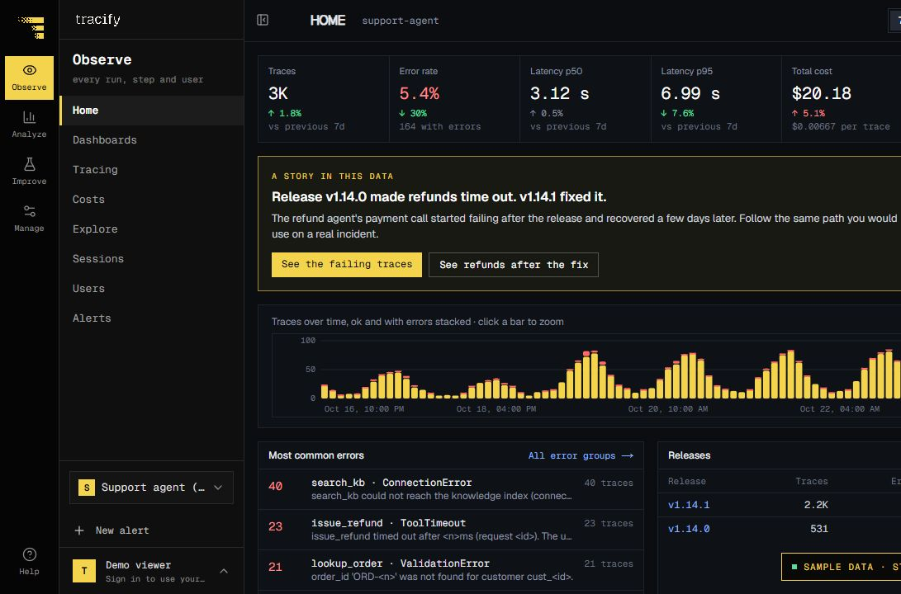

<a href="https://tracify.tech/">
<picture>
<source media="(prefers-color-scheme: dark)" srcset="./assets/tracify-logo-dark.svg" />

</picture>
</a>

<b>Build agents you can trust.</b> AI observability, evaluation, and failure prevention.

Inside Tracify · Public demo with sample data

<h3 align="center">
<a href="https://tracify.tech/">Website</a> ·
<a href="https://tracify.tech/demo/project">Live demo</a> ·
<a href="https://tracify.tech/docs">Quickstart</a>
</h3>

<a href="https://tracify.tech/docs">Documentation</a> ·
<a href="https://tracify.tech/docs/typescript">TypeScript SDK</a> ·
<a href="https://tracify.tech/docs/python">Python SDK</a> ·
<a href="https://tracify.tech/changelog">Changelog</a> ·
<a href="https://tracify.tech/status">Status</a>

---

**Tracify helps teams build agents they can trust.** We help developers understand what their AI agents did, why a run failed, and whether a change made it better. Traces, model calls, tools, evaluations, latency, and cost come together in one place.

<b>Capture → Diagnose → Fix → Verify → Prevent recurrence</b>

### Start building

- **Capture your first run.** Follow the [documentation](https://tracify.tech/docs), or use the [TypeScript](https://tracify.tech/docs/typescript) and [Python](https://tracify.tech/docs/python) guides.
- **Explore Tracify.** Try the [live demo](https://tracify.tech/demo/project), read the [changelog](https://tracify.tech/changelog), and check [service status](https://tracify.tech/status).

Tracify · AI observability, evaluation, and failure prevention

